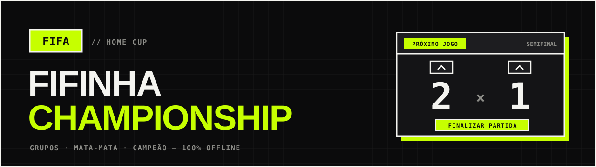
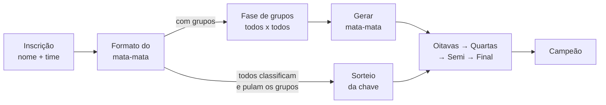

<p align="center">
  
</p>

<p align="center">
  
  
  
  
  
  
</p>

<p align="center"><code>// APRESENTE E ACOMPANHE O CAMPEONATO DA GALERA NA TV DA SALA</code></p>

---

**Fifinha Championship** é um app web para organizar campeonatos caseiros de FIFA. Primeiro todos jogam contra todos, depois os melhores se enfrentam no mata-mata até sair o campeão. Ele foi pensado para ficar aberto num notebook ligado à TV: placares grandes, navegação por carrossel e tudo salvo no próprio navegador. Não precisa de servidor, conta nem internet.

O visual é **neo-brutalista com pegada flat industrial**: bordas grossas, sombras duras, tipografia em caixa alta e uma única cor de destaque verde-limão (`#C6FF00`). O tema escuro é o padrão e também existe um tema claro.

## `00` — Sumário

| | | |
|---|---|---|
| [`01` Como funciona](#01--como-funciona) | [`05` Fase de grupos](#05--fase-de-grupos) | [`09` Menu, backup e persistência](#09--menu-backup-e-persistência) |
| [`02` Rodando o projeto](#02--rodando-o-projeto) | [`06` Mata-mata](#06--mata-mata) | [`10` Temas, animações e responsivo](#10--temas-animações-e-responsivo) |
| [`03` Inscrição](#03--inscrição) | [`07` Campeão](#07--campeão) | [`11` Adicionando ligas e times](#11--adicionando-ligas-e-times) |
| [`04` Formato do mata-mata](#04--formato-do-mata-mata) | [`08` Regras e condições](#08--regras-e-condições) | [`12` Para desenvolvedores](#12--para-desenvolvedores) |

---

## `01` — Como funciona



1. Cada jogador digita o nome e escolhe o time.
2. Você escolhe em que fase o mata-mata começa: final, semifinal, quartas ou oitavas.
3. O app gera os jogos e mostra sempre o **próximo jogo** em destaque.
4. A cada partida finalizada, a classificação se atualiza sozinha, com animação.
5. Encerrados os grupos, os melhores colocados entram numa chave fixa até a final.

---

## `02` — Rodando o projeto

Requer **Node.js 22+** (testado com 22.16).

```bash
npm install
npm run dev        # desenvolvimento  → http://localhost:5173
```

Para usar no dia do campeonato, gere o build e sirva a versão otimizada:

```bash
npm run build      # gera dist/
npm run preview    # serve dist/       → http://localhost:4173
```

| Comando | O que faz |
|---|---|
| `npm run dev` | Servidor de desenvolvimento com hot reload |
| `npm run build` | Typecheck + build estático em `dist/` |
| `npm run preview` | Serve o build localmente |
| `npm test` | Testes da lógica do campeonato (Vitest) |
| `npm run typecheck` | Checagem de tipos |

> [!TIP]
> A pasta `dist/` é um site estático com caminhos relativos. Dá para publicá-la em qualquer hospedagem estática (GitHub Pages, Netlify…) ou simplesmente abrir num servidor local.

---

## `03` — Inscrição

<p align="center">
  
</p>

À esquerda fica o cadastro: nome do jogador, carrossel de ligas e grid de times. À direita fica a lista de inscritos.

**Nome do jogador**
- Até **20 caracteres**, com contador ao lado do campo.
- O nome precisa ser **único**. "Carl" e "carl" contam como o mesmo nome.
- **Enter** confirma a inscrição de qualquer ponto do formulário, inclusive com o foco num time.

**Escolha do time**
- Um **carrossel de ligas**, com uma liga por slide. Cada slide mostra o logo da liga, o nome, a temporada e quantos times ela tem.
- Para navegar entre as ligas:
  - chevrons `‹ ›` nas laterais;
  - **setas ← →** do teclado;
  - **swipe** no celular;
  - indicadores clicáveis com o contador `10 / 27`.
- O carrossel **lembra a última liga** que você visitou.
- Clique num escudo para selecioná-lo e clique de novo para desmarcar. O botão **Confirmar** só fica habilitado com nome e time preenchidos.

**Chave "Time exclusivo"** (ligada por padrão)
- **Ligada:** cada time só pode ter um dono. Times já escolhidos ficam em cinza, desabilitados, e mostram quem os pegou (`↳ Peter`).
- **Desligada:** vários jogadores podem usar o mesmo time.
- Desligar é sempre permitido. **Ligar fica bloqueado** se já houver times repetidos.
- Depois que o campeonato começa, a chave fica travada.

**Lista de inscritos**
- Cada inscrito aparece com posição, escudo, nome e time.
- O **✕** remove o jogador na hora, enquanto o campeonato não começou.
- O contador `05/20` mostra quantas vagas já foram usadas.
- Quando a lista cresce, ela ganha rolagem própria e nunca fica mais alta que o painel de seleção.
- **Iniciar campeonato →** fica habilitado a partir de **2 jogadores**.

<p align="center">
  
  <br><sub><code>TEMA CLARO</code> · times escolhidos ficam desabilitados e mostram o dono</sub>
</p>

---

## `04` — Formato do mata-mata

<p align="center">
  
</p>

Depois da inscrição, você escolhe **em qual fase o mata-mata começa**. Só aparecem as opções que cabem no número de inscritos:

| Fase inicial | Classificados | Disponível a partir de |
|---|---|---|
| **Final** | 2 | 2 jogadores |
| **Semifinal** | 4 | 4 jogadores |
| **Quartas de final** | 8 | 8 jogadores |
| **Oitavas de final** | 16 | 16 jogadores |

- Cada card mostra quantos se classificam, quantos jogos terá a fase de grupos e quantos terá o mata-mata.
- A opção já marcada ao abrir a tela é **a maior que não classifica todo mundo**. Assim a fase de grupos sempre elimina alguém.
- **Pular fase de grupos:** essa chave aparece quando a opção escolhida classifica **todos** os inscritos. Por exemplo, 4 jogadores com Semifinal, ou 2 jogadores com Final. Com ela ligada:
  - a chave é montada por **sorteio** e mostrada antes de começar, com o botão **Sortear de novo**;
  - o slide de classificação não aparece, porque não há fase de grupos.
- **← Voltar à inscrição** permite ajustar a lista antes de começar.

---

## `05` — Fase de grupos

<p align="center">
  
</p>

### Card do próximo jogo

O topo do painel mostra sempre **o próximo jogo**: escudo, jogador e time de cada lado, com a rodada e o número do jogo (`RODADA 1 · JOGO 1/15`).

- O placar é ajustado com **▲** (mais um gol) e **▼** (menos um gol), de 0 a 99.
- **Finalizar partida** registra o resultado, recalcula a tabela e carrega o jogo seguinte.
- O placar em edição fica **salvo como rascunho**: se a página recarregar no meio da partida, nada se perde.

### Jogos fora de ordem e correções

<p align="center">
  
</p>

O slide **Jogos** lista todas as partidas, agrupadas por rodada e com uma barra de progresso (`2/15 jogos realizados`). O vencedor de cada jogo aparece em destaque.

- Clicar em qualquer jogo **o carrega no card do topo** como `JOGO SELECIONADO`. Assim dá para registrar partidas fora da ordem.
- Se o jogo já foi realizado, o card abre com o placar salvo e oferece **Atualizar partida** e **Apagar resultado**, este com confirmação.
- **← voltar ao próximo jogo** retorna ao fluxo normal.

### Geração dos jogos

- O campeonato é em **turno único**: cada par de jogadores se enfrenta uma vez. Com N jogadores, são N × (N − 1) / 2 jogos.
- Os jogos são gerados pelo **método do círculo**: ninguém joga duas vezes na mesma rodada e o app evita, quando possível, que alguém jogue duas partidas seguidas.
- A ordem é embaralhada uma vez, quando o campeonato é criado.

### Classificação

| Coluna | Significado |
|---|---|
| `#` | Posição. A **zona de classificação** fica destacada em verde-limão |
| `J` `V` `E` `D` | Jogos, vitórias, empates e derrotas |
| `GP` `GC` `SG` | Gols pró, gols contra e saldo de gols |
| `PTS` | Pontos: vitória **3**, empate **1**, derrota **0** |

**Critérios de desempate**, nesta ordem:
1. Pontos
2. Saldo de gols
3. Gols marcados
4. **Confronto direto**: uma mini-tabela só entre os empatados, por pontos e depois por saldo
5. **Sorteio**: feito na inscrição e guardado, então a ordem não muda a cada recarregamento

### Fim da fase de grupos

<p align="center">
  
</p>

Quando o último jogo termina, o card do topo mostra os **classificados** e o botão **Gerar mata-mata**.

- O mata-mata **não é gerado automaticamente**. Isso dá a chance de corrigir algum placar antes.
- Ao gerar, os resultados da fase de grupos ficam **travados**. Para destravar, use **Desfazer mata-mata** no menu, que apaga os resultados do mata-mata e pede confirmação.

---

## `06` — Mata-mata

<p align="center">
  
</p>

**Chave fixa por posição**: ela é montada de forma que **1º e 2º só podem se cruzar na final**.

| Fase | Confrontos (posição na fase de grupos) |
|---|---|
| Oitavas | 1×16 · 8×9 · 4×13 · 5×12 · 2×15 · 7×10 · 3×14 · 6×11 |
| Quartas | 1×8 · 4×5 · 2×7 · 3×6 |
| Semifinal | 1×4 · 2×3, ou os vencedores das quartas |
| Final | vencedores das semifinais |

- O slide **Chave** mostra todas as fases. O vencedor de cada jogo fica em verde-limão, o eliminado fica esmaecido e as vagas ainda abertas aparecem como `A DEFINIR`.
- Clicar num confronto da chave o carrega no card do topo.
- Os jogos são **únicos**, sem ida e volta, e **não há disputa de 3º lugar**.

### Pênaltis

<p align="center">
  
</p>

Se o placar estiver **empatado** quando você clicar em **Finalizar partida**, a seção de **pênaltis** se expande, com animação, dentro do mesmo card.

- Os contadores de pênaltis também usam ▲ e ▼.
- O botão vira **Finalizar nos pênaltis** e só é liberado quando houver um vencedor.
- Se você desempatar o placar normal, a seção de pênaltis se recolhe.
- Na chave, os pênaltis aparecem entre parênteses, por exemplo `1 (4)`.

### Trava em cascata

Um resultado do mata-mata pode ser **editado ou apagado enquanto o jogo seguinte do vencedor não tiver sido finalizado**. Por exemplo, a semifinal fica travada quando a final já foi jogada. Mudar o vencedor de um jogo atualiza automaticamente quem está no confronto seguinte.

---

## `07` — Campeão

<p align="center">
  
</p>

Ao finalizar a final, o card do topo vira o **card do campeão**: escudo grande, nome do jogador, time e placar da final, com os pênaltis se houver. O carrossel continua disponível para consultar a classificação, os jogos e a chave completa.

---

## `08` — Regras e condições

| Situação | Comportamento |
|---|---|
| **Mínimo / máximo** de jogadores | 2 / 20 |
| **2 jogadores** | Opção única: Final. Dá para jogar 1 partida de grupos e depois a final, ou pular direto para a final |
| **3 jogadores** | 3 jogos de grupo e final entre os 2 primeiros |
| **4 a 7 jogadores** | Final ou Semifinal (com 4 jogadores, a Semifinal classifica todos e permite pular os grupos) |
| **8 a 15 jogadores** | Final, Semifinal ou Quartas |
| **16 a 20 jogadores** | Final, Semifinal, Quartas ou Oitavas (20 jogadores = 190 jogos de grupo) |
| Empate na fase de grupos | Vale 1 ponto para cada |
| Empate no mata-mata | Decidido nos pênaltis, que precisam ter um vencedor |
| Editar jogo de grupo | Permitido até gerar o mata-mata |
| Editar jogo de mata-mata | Permitido até o jogo seguinte do vencedor ser finalizado |
| Editar inscrições | Só antes de clicar em **Começar** (ou com "Novo campeonato (mesmos jogadores)") |
| Time de um backup que não existe mais em `logos/` | Aparece com um **escudo genérico** com as iniciais e o nome salvo no backup |

---

## `09` — Menu, backup e persistência

Tudo fica salvo no **localStorage** do navegador: inscrições, jogos, resultados, rascunhos de placar, tema e último slide visto de cada carrossel. Fechar a aba ou reiniciar o computador não perde nada.

O **Menu** no canto superior direito oferece:

| Ação | O que faz |
|---|---|
| **Exportar backup** | Baixa um `campeonato-fifa-AAAA-MM-DD.json` com o estado completo |
| **Importar backup** | Valida o arquivo e **substitui** o campeonato atual, pedindo confirmação |
| **Desfazer mata-mata** | Apaga os resultados do mata-mata e destrava a fase de grupos |
| **Novo campeonato (mesmos jogadores)** | Zera jogos e resultados, mantém inscritos e times e volta à inscrição |
| **Novo campeonato (do zero)** | Apaga tudo |

> [!WARNING]
> O localStorage pertence ao navegador e ao endereço onde o app roda. Limpar os dados do navegador, ou abrir o app em outro endereço ou porta, começa um campeonato vazio. **Exporte um backup** antes de trocar de máquina.

Se os dados salvos estiverem corrompidos, o app avisa e começa um campeonato novo, sem apagar os dados antigos até você fazer alguma alteração.

---

## `10` — Temas, animações e responsivo

**Temas**
- **Dark** é o padrão e **Light** é a alternativa, trocados pelo botão no cabeçalho. A escolha fica salva.
- O cabeçalho mostra também a **fase atual**: `INSCRIÇÃO`, `FORMATO`, `FASE DE GRUPOS`, `GRUPOS ENCERRADOS`, `SEMIFINAL`, `ENCERRADO`…
- Todas as cores, fontes e espessuras ficam num único arquivo, [`src/theme/theme.ts`](src/theme/theme.ts):

```ts
export const ACCENT = '#C6FF00';      // cor de destaque
export const PALETTES = { dark: { … }, light: { … } };
export const FONTS = { display: 'Space Grotesk', mono: 'JetBrains Mono' };
export const SHAPE = { borderWidth: '3px', shadowOffset: '6px', radius: '0px' };
```

**Animações**
- **Classificação:** ao finalizar uma partida, cada linha **desliza até a nova posição**. Quem jogou fica verde se subiu e vermelho se desceu, e os pontos brilham. Quem só foi empurrado desliza sem cor.
- **Card do jogo:** o rótulo entra numa varredura, os jogadores entram pelas laterais e o placar sobe. Cada gol faz o número "cair" no lugar.
- **Pênaltis:** a seção expande e recolhe com animação.
- **Carrosséis:** os slides entram deslizando na direção da navegação.
- Com **"reduzir movimento"** ativado no sistema operacional, todas as animações são desligadas.

**Responsivo**
- O layout é pensado primeiro para **TV e desktop**, com placares de até 136px e escudos de 180px, e se adapta ao **celular**: colunas empilhadas, grid de times compacto e menu ocupando a largura da tela.

**Offline**
- As fontes Space Grotesk e JetBrains Mono vêm **embutidas** no build. Nada é carregado da internet.

---

## `11` — Adicionando ligas e times

As ligas são **descobertas automaticamente** a partir da pasta [`logos/`](logos/). Para adicionar uma, copie a pasta baixada do [football-logos.cc](https://football-logos.cc) **sem renomear nada**:

```
logos/
└── spain-la-liga-2026-2027.football-logos.cc/      ← nome da pasta vira o nome e a temporada
    ├── 128x128/*.png                                ← obrigatório (grid, listas, tabela)
    ├── 256x256/*.png                                ← recomendado (card do jogo e do campeão)
    ├── 64x64/  512x512/                             ← ignorados
    ├── spain_la-liga.football-logos.cc.svg          ← opcional: logo da liga
    └── names.json                                   ← opcional: nomes com acento
```

Depois de copiar, reinicie o `npm run dev` ou rode o `npm run build` de novo.

- O sufixo `.football-logos.cc` é removido automaticamente.
- A temporada é extraída do nome da pasta: `…-2026-2027` vira `Temporada 2026/27`.
- Os nomes saem do slug do arquivo: `sao-bernardo` vira "Sao Bernardo". Para acentos e nomes oficiais, crie um `names.json` listando só o que precisa de correção:

```json
{
  "league": "Brasileirão Série B",
  "teams": {
    "sao-bernardo": "São Bernardo",
    "criciuma": "Criciúma"
  }
}
```

Hoje o projeto inclui **27 ligas**, entre elas:
- Brasileirão Séries A e B;
- Premier League e EFL Championship;
- La Liga e La Liga 2;
- Bundesliga e 2. Bundesliga;
- Serie A e Serie B italianas;
- Ligue 1 e Ligue 2;
- Eredivisie, Primeira Liga, MLS e Primera División argentina;
- Champions, Europa e Conference League;
- entre outras.

---

## `12` — Para desenvolvedores

**Stack:** React 19 · TypeScript 7 · Vite 8 · Vitest · CSS puro com variáveis de tema. Não há dependências de UI.

```
src/
├── data/catalog.ts          descoberta de ligas/times em logos/ (import.meta.glob)
├── domain/                  regras puras, sem React, com testes
│   ├── roundRobin.ts        geração dos jogos (método do círculo)
│   ├── standings.ts         classificação e desempates
│   ├── bracket.ts           chaveamento, propagação de vencedores, trava em cascata
│   └── tournament.ts        reducer do estado, seletores e validação de backup
├── store/                   persistência (localStorage) e contexto React
├── screens/                 Inscrição · Formato · Painel · Card do jogo
├── components/              Carrossel · Escudo · Menu · Confirmação · Toggle · Expand · useFlipList
└── theme/theme.ts           cores, fontes e formas
```

- **Requisitos do produto:** [`docs/PRD.md`](docs/PRD.md) reúne todas as decisões de produto e o fluxo completo em Mermaid.
- **Testes:** `npm test` cobre a geração dos jogos, os desempates, o chaveamento, os pênaltis, a trava em cascata, as validações de inscrição e um campeonato completo do início ao campeão.
- **Estado salvo:** fica na chave `fifa-home-championship:v1`, com `schemaVersion` para permitir migrações futuras.

---

<p align="center"><sub><code>ESCUDOS E MARCAS PERTENCEM AOS RESPECTIVOS CLUBES E LIGAS · LOGOS VIA FOOTBALL-LOGOS.CC · PROJETO PESSOAL, SEM FINS COMERCIAIS</code></sub></p>
