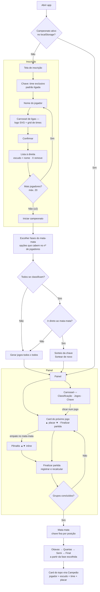

# PRD — Campeonato Caseiro FIFA

> Status: **aprovado** (sessão grill-me, 4 rodadas — confirmado pelo usuário) · Última atualização: 2026-11-19

## 1. Ideia inicial

App web para **apresentar e acompanhar** um campeonato caseiro de FIFA entre amigos:

- Fase de grupos em formato **todos contra todos**, com classificação por pontos e saldo de gols.
- Os melhores avançam para um **mata-mata** cujo tamanho depende do número de jogadores.
- Dados de inscrição e partidas persistidos em **localStorage**.
- Escudos lidos da pasta `logos/`, organizada por liga (subpastas); novas ligas/times serão adicionados no futuro.
- Tela de inscrição: nome do jogador → seleção de liga/time → confirmar.
- Painel com próximo jogo, classificação e jogos navegáveis por carrossel.
- Visual **Neo-brutalismo + Minimalista/Flat industrial de alta performance**, com **light/dark mode** (dark padrão).

## 2. Objetivos

1. Cadastrar jogadores e times de forma rápida, numa tela só.
2. Gerar a tabela de jogos automaticamente e mostrar sempre qual é o próximo jogo.
3. Registrar placares e recalcular a classificação na hora.
4. Levar os classificados ao mata-mata e coroar o campeão.
5. Permitir adicionar ligas/times só colocando arquivos em `logos/`, sem mexer em código.

## 3. Fatos do ambiente (levantados)

| Item | Valor |
|---|---|
| Código existente | Nenhum (projeto vazio, não é repositório git) |
| Runtime | Node v22.16.0 / npm disponível |
| Estrutura de logos | `logos/<liga>.football-logos.cc/<64x64\|128x128\|256x256\|512x512>/<time>.football-logos.cc.png` |
| Ligas atuais | `brazil-serie-b-2025-2026` (20 times), `english-premier-league-2026-2027` (20 times) |
| Formato | Escudos dos times em PNG; **logo da liga em SVG** na raiz da pasta (`brazil_brazilian-serie-b.football-logos.cc.svg`, `england_english-premier-league.football-logos.cc.svg`); `.DS_Store` presentes (ignorar) |
| Nomes | Slugs sem acento (`sao-bernardo`, `criciuma`, `america-mineiro`) |
| Restrição técnica | Navegador não lista diretórios → descoberta de ligas/times em **build time** |

## 4. Decisões tomadas

### 4.1 Plataforma e dados
| # | Decisão |
|---|---|
| D1 | Persistência em **localStorage** |
| D5 | Stack **Vite + React + TypeScript**; site estático |
| D6 | Ligas/times descobertos via `import.meta.glob` em `logos/**` no build/dev (nova liga = copiar pasta + reiniciar dev / rebuild) |
| D7 | Nome de liga/time gerado do slug; `names.json` **opcional** na pasta da liga sobrescreve nomes/acentos (entregue para as 2 ligas atuais) |
| D24 | **Logo da liga** = arquivo `.svg` na raiz da pasta da liga; sem SVG → só o nome em tipografia grande |
| D15 | **Um campeonato ativo**; **exportar/importar JSON** como backup. Sem histórico (futuro) |
| D42 | Menu com **"Novo campeonato (mesmos jogadores)"** (zera jogos/resultados, mantém inscritos e times, volta à inscrição) e **"Novo campeonato (do zero)"** (apaga tudo) — ambos com confirmação |
| D43 | **Importar** substitui o campeonato ativo (com confirmação), após validação do arquivo; time/liga inexistente em `logos/` → escudo genérico + nome do time salvo no arquivo |
| D44 | Execução **local** (`npm run dev` ou `npm run build` + `npm run preview`); `dist/` estático pode ser publicado depois; **sem deploy configurado** |
| D45 | App **100% offline**: nada carregado de CDN |

### 4.2 Regras do campeonato
| # | Decisão |
|---|---|
| D4 | Fase de grupos todos contra todos → mata-mata → campeão |
| D8 | **Mínimo 2 jogadores** |
| D9 | Mata-mata dinâmico: após a inscrição, o usuário **escolhe quantas fases de mata-mata** terá, entre as que cabem no nº de inscritos (Final=2, Semi=4, Quartas=8, Oitavas=16 classificados) |
| D25 | Se a opção escolhida classifica **todos** os jogadores, é oferecida a opção de **ir direto ao mata-mata** (pular fase de grupos) |
| D26 | Máximo de **20 jogadores** |
| D27 | Chave **fixa por posição** (1º e 2º só se cruzam na final): Oitavas 1x16, 8x9, 4x13, 5x12, 2x15, 7x10, 3x14, 6x11 · Quartas 1x8, 4x5, 2x7, 3x6 · Semi (4 classif.) 1x4, 2x3 |
| D10 | Fase de grupos em **turno único** (sem opção de ida e volta) |
| D11 | Pontos: V=3, E=1, D=0. Desempate: pontos → saldo → gols marcados → confronto direto → sorteio (sorteio persistido) |
| D12 | **Chave "Time exclusivo"**: quando ligada, cada time só pode ser escolhido por um jogador (times ocupados aparecem desabilitados com o nome de quem escolheu) |
| D13 | Mata-mata em **jogo único**; empate → registra placar dos **pênaltis**; **sem disputa de 3º lugar** |
| D14 | Ordem dos jogos de grupo pelo **método do círculo**, embaralhada uma vez na criação; "próximo jogo" = primeiro não jogado; pode registrar fora de ordem |
| D16 | Placares de grupo editáveis/apagáveis enquanto a fase está aberta (recalcula tabela); travados após gerar o mata-mata (destravar = desfazer mata-mata, com confirmação) |

### 4.3 Telas e UX
| # | Decisão |
|---|---|
| D2 | Dark mode padrão, alternância para light (preferência salva) |
| D3 | Estilo Neo-brutalismo + Flat industrial |
| D17 | Foco em **desktop/TV**, responsivo para celular |
| D18 | Idioma **Português (BR)** |
| D19 | **Tela de inscrição**: coluna esquerda = nome do jogador + carrossel de ligas (chevrons) com grid de times + botão Confirmar; coluna direita = lista de inscritos (escudo do time + nome do jogador) |
| D20 | Seleção de liga por **carrossel com chevrons** laterais (uma liga por slide, com seu grid de times) |
| D21 | **Painel**: card do **Próximo jogo fixo no topo**; abaixo, **carrossel ‹ ›** com slides Classificação · Jogos · Chaveamento (este último quando o mata-mata começa). Cabeçalho: toggle de tema + menu (Exportar, Importar, Novo campeonato) |
| D28 | Classificação: Pos, escudo, jogador, J, V, E, D, GP, GC, SG, Pts; zona de classificados destacada em accent |
| D29 | **Placar editado no próprio card do próximo jogo**: chevron ▲ acima do número incrementa, chevron ▼ abaixo decrementa (mínimo 0); **botão "Finalizar partida" centralizado** registra o resultado na tabela |
| D30 | Inscrição: Confirmar habilitado só com nome + time; nome único (case-insensitive), máx. 20 caracteres; Enter confirma; X remove inscrito até iniciar; "Iniciar campeonato" no rodapé da lista, habilitado com ≥2 |
| D31 | Chave "Time exclusivo" no topo da inscrição, **ligada por padrão**; desligar sempre permitido; ligar bloqueado se houver time repetido; travada após iniciar |
| D32 | Carrosséis: chevrons grandes nas laterais + setas do teclado + swipe; indicadores do slide atual (no painel, rótulos clicáveis); **sem loop** (chevron desabilitado nas pontas); lembra o último slide |
| D33 | **Campeão**: apenas as informações (sem animação, sem faixa) |
| D34 | Sem conceito de mandante: jogador A à esquerda, B à direita |
| D35 | Tela **"Formato do mata-mata"** após "Iniciar campeonato": um card por opção válida (fase inicial, nº de classificados, nº de jogos de grupo); pré-seleção = maior opção que **não** classifica todos; chave "Pular fase de grupos" (padrão desligada) aparece só quando a opção classifica todos; botão "Começar" |
| D36 | Sem fase de grupos → **sorteio aleatório** das posições da chave, exibido antes de começar, com "Sortear de novo"; slide Classificação oculto |
| D37 | **Pênaltis inline**: empate no mata-mata ao finalizar → surgem contadores ▲▼ de pênaltis no mesmo card; botão "Finalizar nos pênaltis" só habilita com vencedor |
| D38 | Clicar num jogo no slide Jogos o **carrega no card do topo** ("JOGO SELECIONADO" + "← voltar ao próximo jogo"); jogo já jogado abre com placar salvo, botão "Atualizar partida" + "Apagar resultado" (com confirmação), respeitando D16 |
| D39 | Ao finalizar a final, o **card do topo vira o card do campeão**: rótulo "CAMPEÃO", escudo grande, jogador, time e placar da final; carrossel continua disponível |
| D40 | **Rascunho do placar** (▲▼ ainda não finalizado) persistido no localStorage |
| D41 | Resultado de mata-mata editável/apagável só enquanto o jogo seguinte do vencedor não foi finalizado (**trava em cascata**) |

### 4.4 Tema
| # | Decisão |
|---|---|
| D22 | Cor de destaque **verde-limão ácido `#C6FF00`** |
| D46 | Fontes **embutidas** (sem Google Fonts): **Space Grotesk** (títulos/nomes, caixa alta) e **JetBrains Mono** (placares/números); definidas nas constantes de tema |
| D23 | Todas as cores em **constantes/tokens globais num único arquivo** (accent, fundo, superfície, texto, borda, sombra, sucesso/erro…) para os dois temas, para fácil troca e experimentação |

## 5. Como adicionar uma nova liga

Copiar a pasta exatamente como baixada do football-logos.cc para dentro de `logos/`:

```
logos/
└── spain-la-liga-2026-2027.football-logos.cc/   ← nome da pasta vira o id/nome da liga
    ├── 128x128/            ← obrigatório (grid de seleção, listas)
    │   └── real-madrid.football-logos.cc.png
    ├── 256x256/            ← recomendado (card do próximo jogo, campeão); fallback = 128
    ├── 64x64/ 512x512/     ← opcionais, ignorados
    ├── spain_la-liga.football-logos.cc.svg   ← opcional: logo da liga (qualquer .svg na raiz)
    └── names.json          ← opcional: { "league": "La Liga", "teams": { "atletico-madrid": "Atlético de Madrid" } }
```

O sufixo `.football-logos.cc` é removido automaticamente. Depois de copiar: reiniciar `npm run dev` (ou rodar `npm run build`).

## 6. Perguntas em aberto

Nenhuma — todos os ramos da árvore de decisão foram visitados.

## 6.1 Notas técnicas (decisões de implementação, sem impacto de produto)

- Estado salvo no localStorage sob uma chave versionada (`fifa-home-championship:v1`), com campo `schemaVersion` para migrações futuras; tema e últimos slides vistos em chaves separadas.
- Toda leitura/escrita do localStorage protegida por try/catch; estado inválido → oferece "começar do zero" sem quebrar.
- Imagens: `128x128` no grid, listas e tabela; `256x256` no card do próximo jogo e do campeão (fallback para 128).
- Lógica de campeonato (geração round-robin, classificação/desempate, chaveamento) isolada em funções puras com testes unitários (Vitest).

## 7. Fluxo atual


